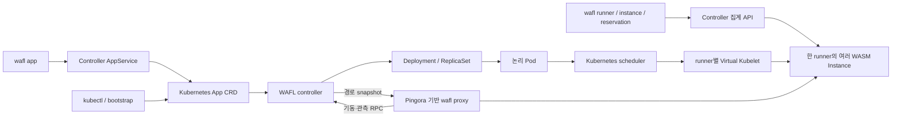

# Controller와 Virtual Kubelet

플랫폼의 설치·로컬 개발은 [Kubernetes native 튜토리얼](kubernetes-native.md)을 따릅니다. PostgreSQL 기반 controller와 별도 runner 목록 설정은 제거했습니다.

controller는 App에서 Deployment를 생성하고 Secret을 불변 snapshot으로 변환합니다. Kubernetes scheduler가 가상 Node를 선택하고 ReplicaSet이 실행 개수를 유지합니다. Virtual Kubelet provider는 생성된 Instance RPC로 runner를 제어하고 readiness와 종료 상태를 Pod status로 보고합니다. 앱마다 Linux 컨테이너를 새로 띄우지 않습니다.

controller는 여러 replica로 실행할 수 있습니다. Kubernetes Lease 소유자만 배포·증감·회수를 조정하고 모든 replica가 App/Traffic RPC, Runner·Instance·Reservation 집계, 로그 중계, 프록시 경로 snapshot과 기동 요청을 처리합니다. API 변경은 resourceVersion으로 충돌을 확인합니다. 조정 leader가 바뀌어도 App·Deployment·관측 기록·실행 receipt는 Kubernetes에 남습니다.

| 구성요소 | 기본 주소 / 명령 |
| --- | --- |
| controller | `wafl serve controller`, `:8082`의 `/health`, `/proxy`, App/Traffic 및 Instance/Runner/Reservation RPC |
| node provider | `wafl serve node --node NAME --runner http://RUNNER:8081` |
| runner | `wafl serve runner`, 생성된 Instance/Runner/Reservation RPC |
| proxy | `wafl serve proxy`, HTTP/gRPC `:8080`, 일반 TCP `:10000`–`:10015`, readiness `:8084` |

프록시의 `--controller`에 controller API 주소를 지정합니다. App Service도 같은 프록시를 통하므로 내부·외부 호출이 같은 수신·drain 계약을 따릅니다. HTTP/gRPC와 일반 TCP 모두 준비된 WASM 소켓으로 직접 전달하며, 첫 요청도 프록시가 기동을 기다렸다가 직접 전달합니다. controller는 앱 데이터를 중계하지 않습니다. 자세한 설정과 전환 절차는 [프록시 문서](proxy.md)에 있습니다.

가상 Node와 논리 Pod는 WAFL의 제한된 실행 계약입니다. 일반 kubelet의 Linux 컨테이너·exec·CSI·Pod별 CNI를 구현하지 않습니다. 상세 지원 범위와 장애 후 예약 회수는 [플랫폼 계약](kubernetes-native.md)에 있습니다.

클라이언트 계약과 Secret·번들 전달은 [controller API](controller-api.md)에 있습니다. Kubernetes credentials는 controller/node 서버와 별도 운영자 도구만 사용합니다. `AppService.Tail`은 runner의 스트림을 중계하며 클라이언트는 runner Pod IP나 Kubernetes port-forward를 알 필요가 없습니다.

같은 controller 주소의 `wafl runner list`, `wafl instance list`, `wafl reservation list`는 감독하는 runner들을 제한된 병렬 요청으로 조회합니다. 실패한 runner는 로그와 CLI stderr 경고에 남기고 정상 결과를 반환합니다. 이 조회는 leader 전용 작업이 아니며 별도 관측 DB나 controller 메모리 캐시를 요구하지 않습니다. 구체적인 세션 선택과 부분 결과 계약은 [집계 API](controller-api.md)를 참고하세요.
